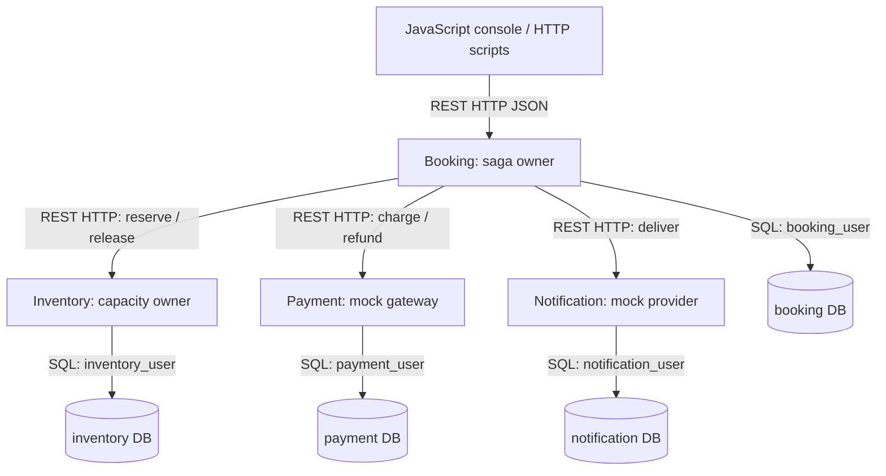
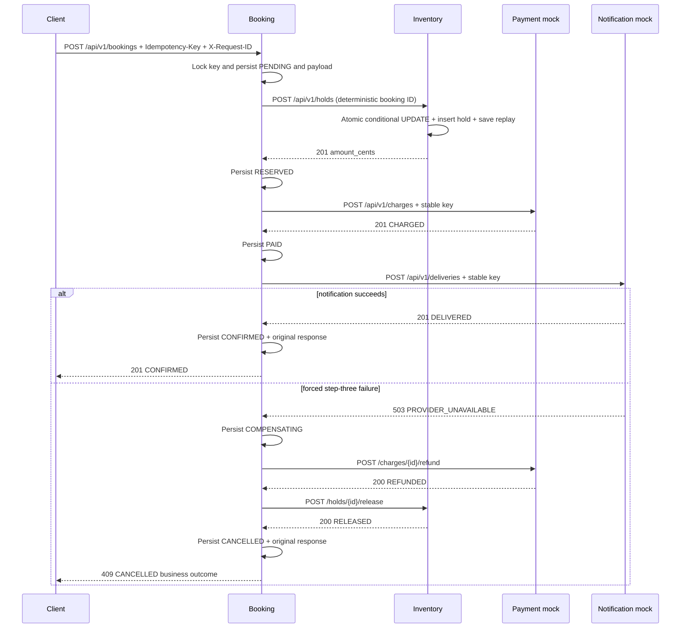
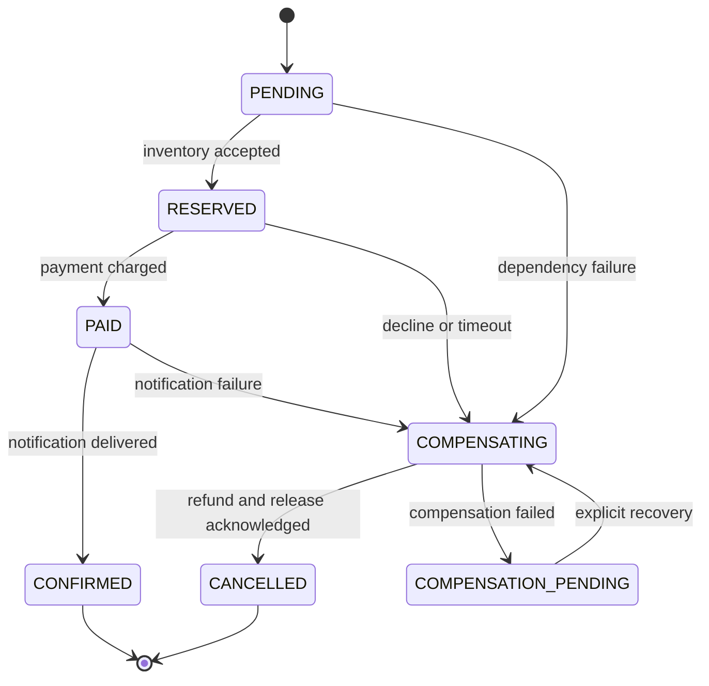
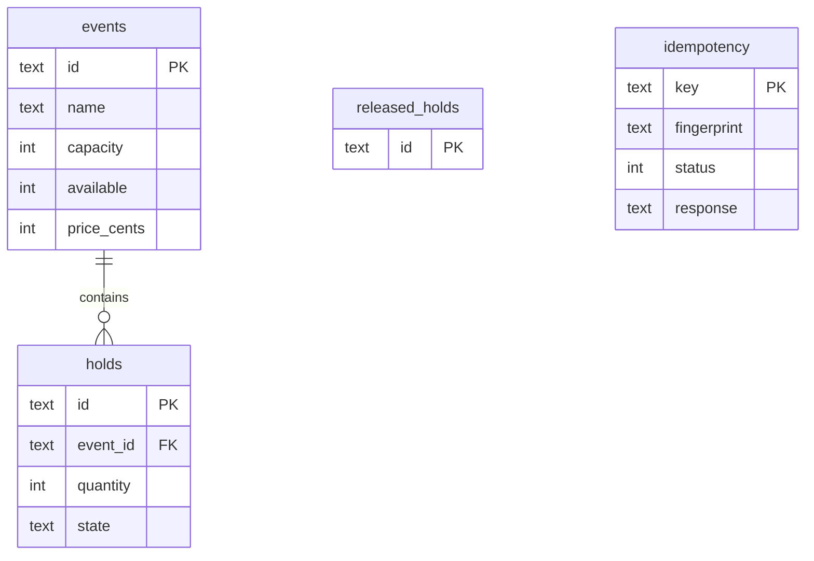
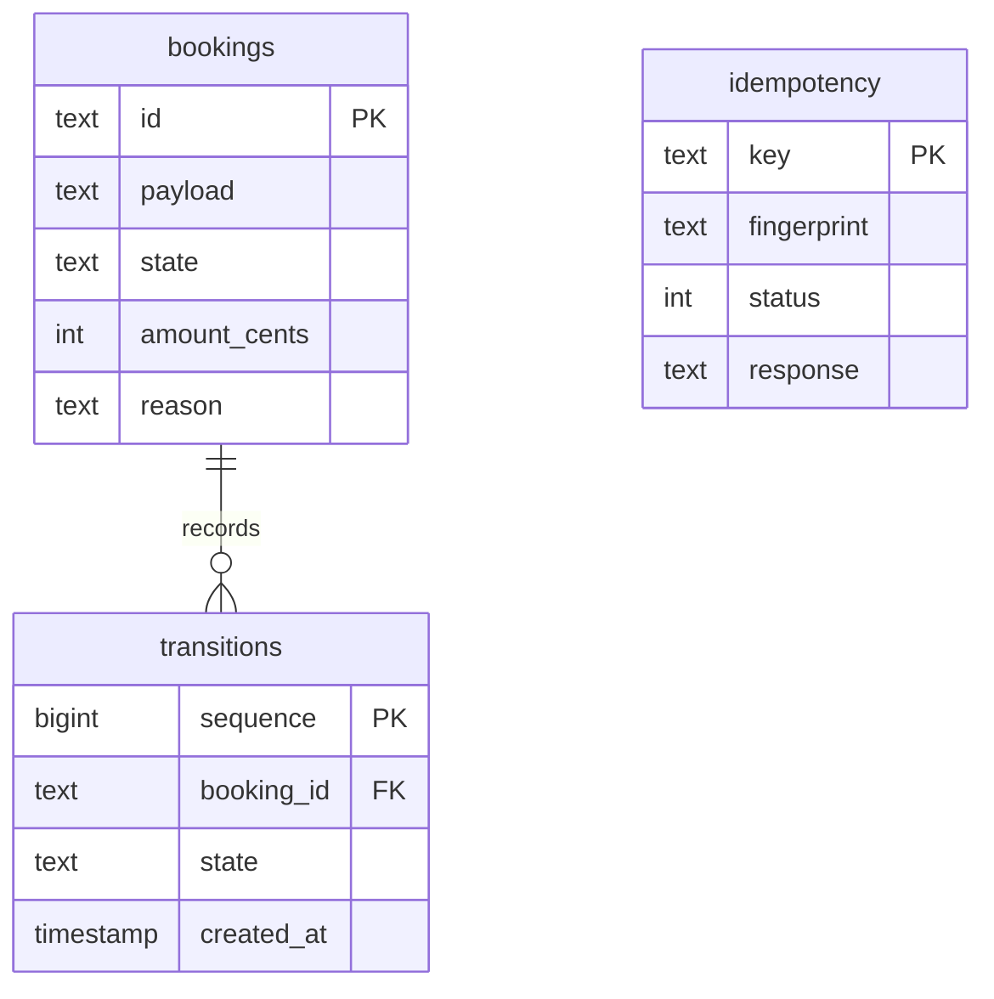
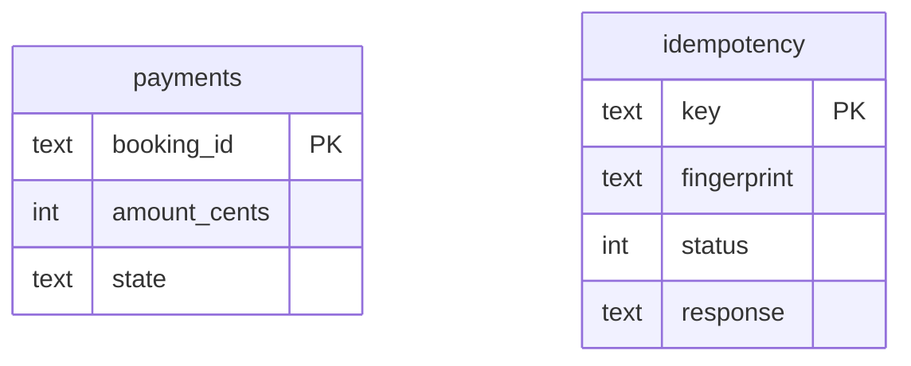
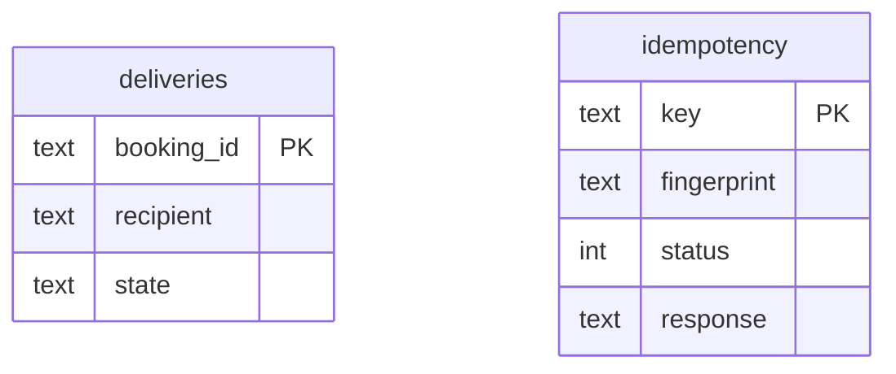

# Editable diagrams

## Components

## Main transaction and step-three failure

Each inter-service arrow is HTTP JSON. Each service commits only its own database.
If a compensation call fails, persist COMPENSATION_PENDING; after restoring the service,
the operator invokes recover. Stable IDs and local fences make repeated work harmless.

## Booking state machine

## Inventory ER

## Booking ER

## Payment ER

## Notification ER

`booking_id` in Payment/Notification and a hold's ID reference a remote concept, **not a
cross-database foreign key**. Only events-to-holds and bookings-to-transitions are local FKs.